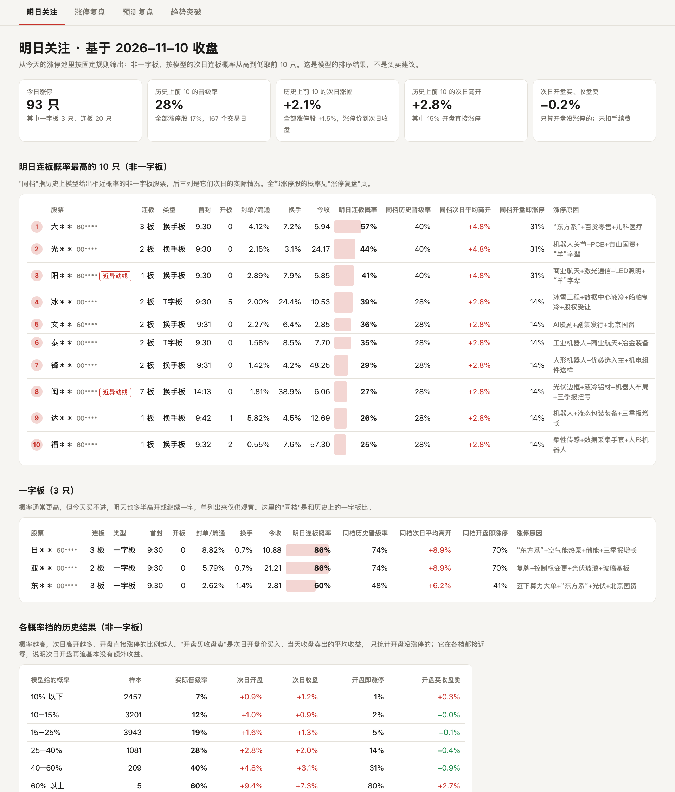
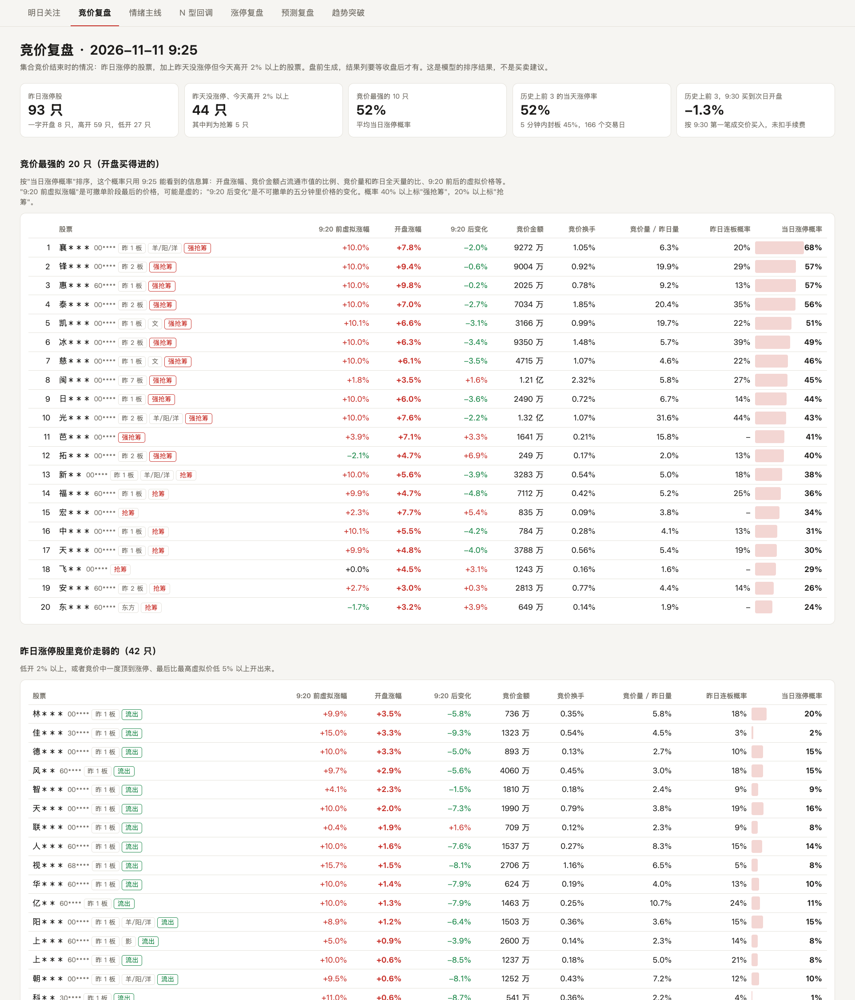
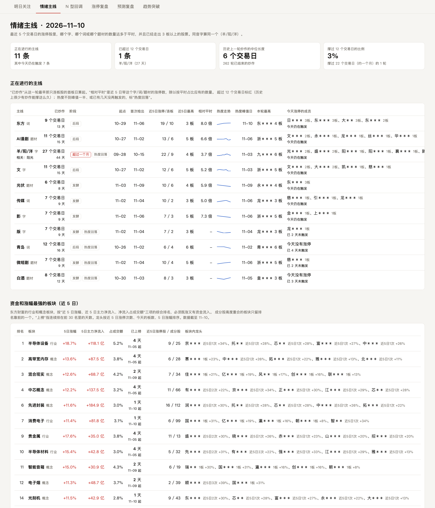
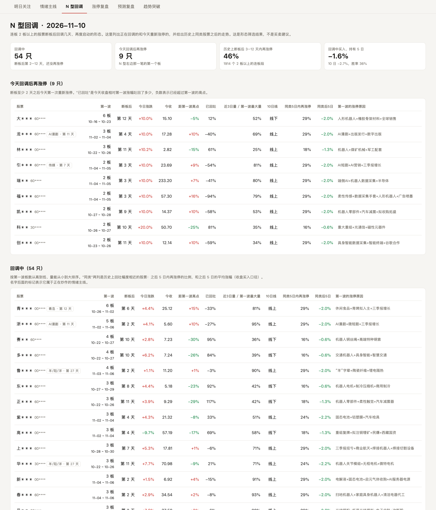
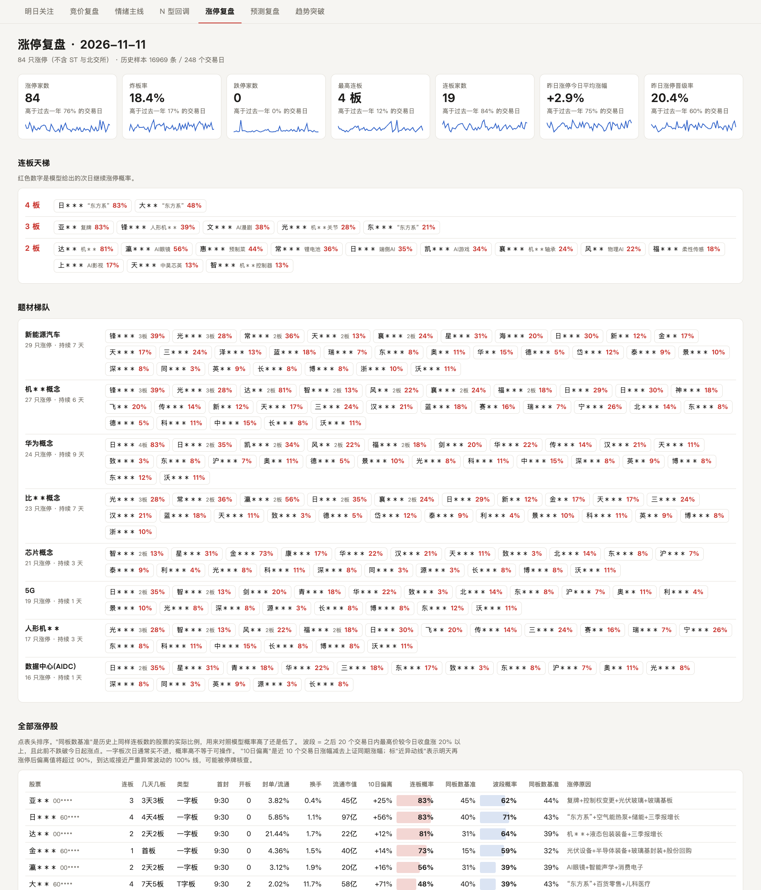
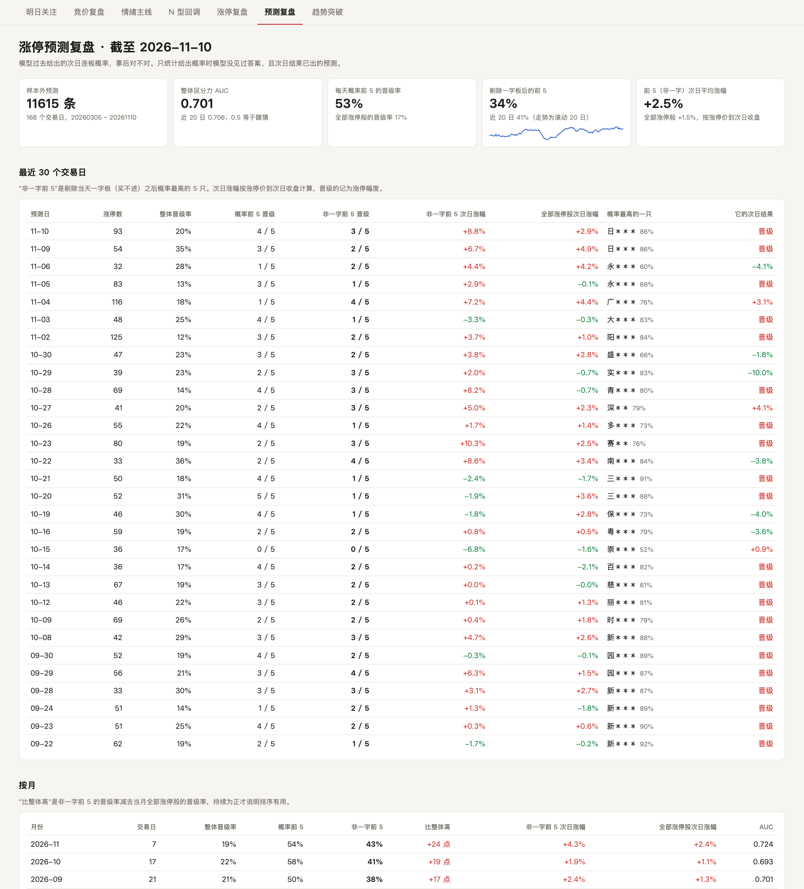
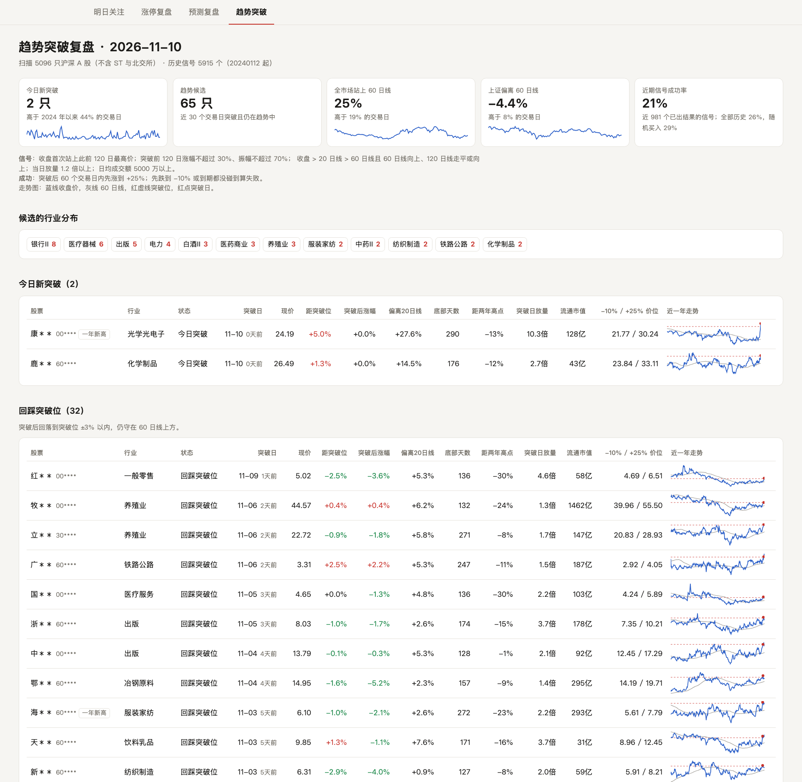

# A股打板复盘

每个交易日收盘后跑一条命令，自动生成当天的涨停复盘页：涨停池和连板天梯、每只涨停股的明日连板概率、"明日关注"名单、过去预测的事后复盘，以及全市场的趋势突破候选。每天 9:25 还可以再跑一条命令，看集合竞价里哪些股票在抢筹、哪些在流出。

数据全部来自公开行情接口，单机运行，不需要付费数据或账号。

> 输出的是历史统计概率，不是荐股，不构成任何投资建议。



*示例截图，股票名称和代码已打码。*

## 目录

- [一、安装](#一安装)
- [二、第一次运行](#二第一次运行)
- [三、看结果](#三看结果)
- [四、每天怎么用](#四每天怎么用)
- [五、命令一览](#五命令一览)
- [六、七个标签页怎么读](#六七个标签页怎么读)
- [七、数据和文件](#七数据和文件)
- [八、调参数](#八调参数)
- [九、常见问题](#九常见问题)
- [十、回测结论](#十回测结论)

## 一、安装

需要 Python 3.9 或更高版本（开发时用的是 3.11）。

```bash
git clone https://github.com/hhhhhh1140/zt-fupan.git
```

```bash
cd zt-fupan
```

```bash
pip install -r requirements.txt
```

```bash
pip install -e .
```

第二条把项目装成一个包，之后 `python -m ztfp ...` 在任何目录下都能运行，不用先 `cd` 进项目。

依赖有八个：requests、pandas、numpy、scikit-learn、scipy、pyarrow、pypinyin、pytdx。装了 Anaconda 的话前六个都自带，只需要 `pip install pypinyin pytdx`。
pypinyin 用来把同音字归到一起（羊/阳/洋），不装也能跑，只是情绪主线里每个字单独统计。
pytdx 用来从通达信行情服务器取集合竞价的逐笔数据，只有竞价复盘用到。

确认装好了：

```bash
python -c "import requests, pandas, numpy, sklearn; print('ok')"
```

如果你的电脑上 `python` 指向的不是装了依赖的那个解释器（macOS 上常见，系统自带的 `python3` 没有 pandas），下面所有命令里的 `python` 都换成完整路径，例如 `/opt/anaconda3/bin/python3`。

## 二、第一次运行

在项目根目录（能看到 `ztfp/` 文件夹的那一层）运行：

```bash
python -m ztfp daily
```

第一次会回填历史数据，之后每天只补当天的：

| 步骤 | 做什么 | 第一次的量 |
|---|---|---|
| 1. 采集涨停数据 | 同花顺的涨停池、炸板池、跌停池、连板天梯、题材榜 | 最近约一年，240 多个交易日 |
| 2. 采集涨停股日K | 出现过涨停或炸板的股票的前复权日K | 约 3800 只 |
| 3. 特征和标签 | 把每条涨停记录加工成特征，标上次日是否连板 | 约 1.7 万条 |
| 4. 训练和回测 | 每 5 个交易日滚动重训，给出样本外的连板概率 | 几十秒 |
| 5. 采集全市场日K | 趋势突破用，2023 年起 | 约 5000 只 |
| 6. 扫描趋势信号 | 找突破信号和当前候选 | 约 1 分钟 |
| 7. 生成复盘页 | 合并成一个带标签页的 HTML | 几秒 |

第一次整体大约需要十几分钟，主要花在第 2 步和第 5 步的下载上，取决于网络。之后每天运行只要几分钟。

运行结束时终端会打印复盘页的位置：

```
合并复盘页: .../reports/fupan_20261110.html
```

注意两点：

- **要在收盘后跑**。15:10 之前运行不会采集当天的数据，页面停留在上一个交易日。
- **不要挂代理访问国内行情接口**。程序已经强制直连，不受系统代理设置影响，一般不用管。

## 三、看结果

生成的页面是单个 HTML 文件，不需要服务器：

- `reports/index.html`：永远是最新一天。
- `reports/fupan_日期.html`：每天存一份，方便回看。

直接双击 `reports/index.html` 用浏览器打开即可。也可以用命令打开：

```bash
open reports/index.html
```

（Windows 用 `start reports\index.html`，Linux 用 `xdg-open reports/index.html`。）

想在手机或局域网里的其它设备上看，可以起一个临时的本地服务：

```bash
python -m http.server 8765 --directory reports
```

然后浏览器访问 `http://localhost:8765/`。

页面顶部有七个标签页，点击切换：**明日关注**、**竞价复盘**、**情绪主线**、**N 型回调**、**涨停复盘**、**预测复盘**、**趋势突破**。表格的表头大多可以点击排序，页面自动适配深色模式。

## 四、每天怎么用

1. 收盘后（15:10 之后）运行 `python -m ztfp daily`。
2. 打开 `reports/index.html`。
3. 先看"明日关注"，再到"涨停复盘"看情绪和题材，最后用"预测复盘"核对昨天的预测。
4. 第二天 9:25 集合竞价结束后运行 `python -m ztfp auction`，大约半分钟，打开终端里提示的 `reports/auction_日期.html`。前一天收盘后必须跑过 `daily`，否则不知道昨天谁涨停。

想让它每天自动跑，macOS / Linux 可以加一条定时任务（周一到周五 15:30）：

```bash
crontab -e
```

加入下面这一行，把两处路径换成你自己的：

```
30 15 * * 1-5 cd /你的路径/zt-fupan && /你的python路径/python -m ztfp daily >> daily.log 2>&1
```

Windows 用"任务计划程序"建一个每天 15:30 触发的任务，执行同样的命令。

节假日也会触发，但没有新的交易日数据时程序什么都不会采集，只是重新生成一遍页面。

中间漏跑了几天没关系，下次运行会把缺的交易日补上。但同花顺只保留约一年的涨停数据，超过一年没跑的部分就补不回来了。

## 五、命令一览

| 命令 | 作用 |
|---|---|
| `python -m ztfp daily` | 全流程：采集、特征、训练、趋势扫描、生成合并页 |
| `python -m ztfp page` | 不采集，只用已有数据重新生成合并页 |
| `python -m ztfp update` | 只采集涨停数据和涨停股日K |
| `python -m ztfp build` | 只重建特征和标签 |
| `python -m ztfp train` | 只重新训练，并在终端打印回测指标 |
| `python -m ztfp report 20261106` | 单独生成某个历史交易日的涨停复盘页（不带日期则是最新一天） |
| `python -m ztfp review` | 单独生成预测复盘页 |
| `python -m ztfp auction` | 9:25 之后跑：抓当天集合竞价，生成竞价复盘页 |
| `python -m ztfp auction 20261110` | 回看某个历史交易日的竞价复盘（带当天实际结果） |
| `python -m ztfp auction fetch` | 回填历史竞价数据。第一次要跑一两个小时，可以中断后接着跑；`daily` 每天会自动补当天的 |
| `python -m ztfp nshape` | 只生成 N 型回调页（需要先跑过 `trend`，要用全市场日K） |
| `python -m ztfp hot` | 只跑情绪主线：更新板块数据、重新检测、生成页面 |
| `python -m ztfp sector` | 只更新东方财富的板块行情、主力资金流和成分股 |
| `python -m ztfp trend` | 只跑趋势突破：采集全市场日K、扫描、回测、生成页面 |
| `python -m ztfp.trend_lab` | 研究用：建全市场"股票-交易日"面板，用来测试新的趋势信号 |

## 六、七个标签页怎么读

### 明日关注

页面分两块。

**明日关注的主线和板块**。把"在炒什么"和"里面有谁"放在一起看：

- 前面几行是正在炒作的情绪主线（字、词、题材），带已炒作天数。
- 中间是近 5 日涨幅和主力资金流入综合最强的板块，带上榜天数。
- 最后几行是涨得多但主力资金流出的板块。
- 每一行都列出**今天涨停的成员**（板数和明日连板概率）和**没涨停但近 5 日最强的成员**（近 5 日涨幅）。

**明日连板概率最高的 10 只**。从当天涨停池里按固定规则筛出来的名单：**非一字板，按模型的次日连板概率从高到低取前 10 只**。每只股票多了一列"所属主线 / 强势板块"。一字板单独列在下面，因为当天买不进。

每只股票除了概率，还有三列"同档"数据：历史上模型给出相近概率的股票，次日实际的晋级率、平均高开幅度、开盘直接涨停的比例。用它判断第二天开盘后的价位还值不值得参与。

页面最下面是各概率档的历史结果表，其中"开盘买收盘卖"一列是次日开盘价买入、当天收盘卖出的平均收益。

名字后面如果带"羊 · 第 27 天"这样的标记，表示这只股票属于正在炒作的情绪主线，以及这条主线已经炒了多少个交易日。

（截图见本文开头。）

### 竞价复盘



打板要看集合竞价。这一页回答两个问题：昨天的涨停股今天谁在被抢筹、谁在流出；昨天没涨停的股票里，谁的竞价突然很猛。

范围是**昨日涨停的股票**，加上**昨天没涨停但今天高开 2% 以上的股票**。

集合竞价分两段：9:15–9:20 可以撤单，这时挂在涨停价的单子可能是虚的；9:20–9:25 不能撤单，价格才是真的。所以表里把两段分开：

- **9:20 前虚拟涨幅**：可撤单阶段最后的虚拟价格，只作参考。
- **开盘涨幅**：9:25 实际撮合出来的开盘价。
- **9:20 后变化**：不可撤单的五分钟里价格的变化。前面顶在涨停、这里大幅回落，说明之前的单子撤了。
- **竞价金额、竞价换手、竞价量 / 昨日量**：竞价阶段真金白银成交了多少。
- **当日涨停概率**：模型只用 9:25 能看到的信息算出来的、当天收盘涨停的概率。

标签的意思：

- **一字开盘**：开盘就在涨停价，买不进，单独看。
- **强抢筹 / 抢筹**：当日涨停概率 40% 以上 / 20% 以上。
- **流出**：昨日涨停，今天低开 2% 以上，或者竞价中一度顶到涨停、最后比最高虚拟价低 5% 以上开出来。

页面依次是：竞价最强的 20 只、昨日涨停股里竞价走弱的、昨日涨停股全表、最近 5 个交易日竞价前几名的实际结果、历史统计。盘前生成时"结果"列是空的，收盘后跑过 `daily` 再用 `python -m ztfp auction 日期` 重新生成就有了。

9:30 之前跑的话还没有"9:30 第一笔成交价"，不影响排名。

### 情绪主线



回答两个问题：现在市场在炒什么，已经炒了多久。

**正在进行的主线**。从最近 5 个交易日的涨停股里找三类线索：

| 线索 | 例子 | 怎么算 |
|---|---|---|
| 字 | 羊/阳/洋、华 | 股票名字里的字，同音字合并；同花顺标了"X字辈"的也算 |
| 词 | 东方、新华、传媒 | 股票名字里的两字词 |
| 题材 | AI漫剧、光伏、人形机器人 | 同花顺的涨停原因标签，业绩、国资这类不算 |

带某个字、词或题材的涨停数是平时的 3 倍以上，并且里面已经走出 3 板以上的股票，就算一条主线。各列的意思：

- **已炒作**：从这一轮最早那只连板股的首板日算起的交易日数。
- **阶段**：1–5 天起势，6–8 天发酵，9–12 天后段，13 天以上标红。历史上一轮炒作的中位长度是 6 个交易日，只有约 3% 能超过 12 个交易日。
- **热度回落**：热度不到峰值的一半，或者已经几天没有再触发。
- **相对平时**：近 5 日的涨停数除以按平时占比应有的数量。
- **本轮最高**、**今天涨停的成员**：这条主线里走得最高的股票，和今天还在涨停的股票。

**资金和涨幅最强的板块**。东方财富的行业和概念板块，按近 5 日涨幅、近 5 日主力净流入、净流入占成交额三项综合排名，必须既涨又有资金流入。每个板块列出已上榜天数和板块内龙头（按近 5 日涨停次数、今天的板数、5 日涨幅排序）。

**涨得多但主力资金在流出的板块**。情绪炒作的板块经常在这里：股价靠小单和游资推上去，按大单口径统计反而是净流出。所以这张表要和上一张一起看，只看"流入最多"会漏掉情绪主线。

页面下半部分是历史统计：炒作到第几天时里面的涨停股次日表现如何、一轮炒作能持续多久、过去有哪些主线。

### N 型回调



很多连板股 2–3 板之后断板，回调几天又重新启动，日K上走出一个 N 字。这一页把这类股票找出来。

- **第一波**：2 板以上的连板段。
- **今天回调后再涨停**：断板至少 2 天之后，今天第一次重新涨停。
- **回调中**：断板后第 2–12 天，还没有再涨停过。按第一波板数从高到低、量能从小到大排序。

各列的意思：

- **距第一波高点**：今天收盘相对最后一个板收盘价的涨跌。
- **已回吐**：第一波的涨幅吐回了多少。100% 表示回到起涨点，负数表示已经超过第一波的高点。
- **近3日量 / 第一波最大量**：回调时缩量到了什么程度。
- **同类5日内再涨停、同类后5日**：历史上回吐幅度相近的股票，之后 5 日内再涨停的比例和 5 日平均涨幅。

页面下半部分是历史统计：断板之后会发生什么、回调中买入的结果（按回吐幅度、量能、第一波板数分组）、回调后再涨停的那个板次日表现如何。

这一页需要全市场日K，第一次用之前要先跑过 `python -m ztfp trend`。

### 涨停复盘

- **情绪指标**：涨停家数、炸板率、跌停家数、最高连板、连板家数、昨日涨停今日平均涨幅、昨日涨停晋级率。每项都标出它高于过去一年多少比例的交易日，并附 60 日走势。
- **连板天梯**：按连板数分层，每只股票后面的红色数字是明日连板概率。
- **题材梯队**：当天涨停最多的 8 个题材和里面的股票。
- **全部涨停股**：每只股票的封板时间、开板次数、封单比、换手、10 日偏离值、连板概率、波段概率。"同板数基准"是历史上相同连板数股票的实际比例，用来对照模型概率是高了还是低了。标"近异动线"表示明天再涨停，10 日偏离值就会到达或接近严重异常波动的 100% 线。
- **上一交易日预测回看**：昨天概率最高的 10 只今天的结果。
- **历史统计**：按连板数、涨停类型、首封时间、开板次数、炸板率、10cm/20cm 分组的次日连板率和后续表现。
- **模型可信度**：样本外回测的 AUC，以及按预测概率分五档后的实际命中率。



### 预测复盘

回答"模型过去说的概率，事后看准不准"。只统计给出概率时模型没见过答案、且次日结果已经出来的预测，所以它截至的日期比涨停复盘早一个交易日。

- **最近 30 个交易日**：每天概率前 5 只晋级了几只，概率最高的那只结果如何。
- **按月**：前 5 的晋级率比当月整体高多少。持续为正才说明排序有用。
- **概率分档**：模型说的概率和实际晋级率是否一致。
- **偏差**：模型在哪类股票上偏高或偏低。
- **看走眼的**：近 10 天概率高却没晋级的，和概率低却晋级的。



### 趋势突破

找长期横盘或阴跌之后，均线拐头并放量突破关键位的股票。

信号定义：

1. 收盘首次站上此前 120 个交易日的最高价（突破位），且之前 20 天内没突破过。
2. 突破前 120 日涨幅不超过 30%，振幅不超过 70%。
3. 收盘 > 20 日线 > 60 日线，60 日线向上，120 日线走平或向上。
4. 当日成交量是前 50 日均量的 1.2 倍以上。
5. 20 日日均成交额 5000 万以上，上市满 250 个交易日。

候选分三类：**今日突破**、**回踩突破位**（回落到突破位 ±3% 以内）、**突破后上行中**。每只股票附近一年走势小图：蓝线是收盘价，灰线是 60 日线，红虚线是突破位，红点是突破日。

页面下方有两张对照表，建议每次都看一眼：

- **市场状态与成功率**：不同市场强弱下，突破信号和随机买入各自的成功率，并标出今天所在的区间。
- **这个形态的历史表现**：突破当天买、等回踩再买、随机买入三种方式的对比。



## 七、数据和文件

```
zt-fupan/
├── ztfp/
│   ├── __main__.py      命令入口
│   ├── fetch.py         涨停数据和日K的采集
│   ├── db.py            涨停数据库的表结构
│   ├── features.py      特征和标签（定义在文件顶部）
│   ├── model.py         连板/波段概率模型和滚动回测
│   ├── report.py        涨停复盘页
│   ├── review.py        预测复盘页
│   ├── auction.py       集合竞价的采集、当日涨停概率模型和页面
│   ├── nshape.py        N 型回调的筛选、历史统计和页面
│   ├── hot.py           情绪主线检测和页面（参数在文件顶部）
│   ├── sector.py        东方财富板块行情、主力资金流、成分股
│   ├── trend_data.py    全市场股票列表和日K
│   ├── trend.py         趋势突破信号、候选和页面（参数在文件顶部）
│   ├── trend_lab.py     趋势信号研究面板
│   └── page.py          明日关注名单和合并页
├── data/                运行后生成，不进 Git
│   ├── ztfp.db          涨停数据、涨停股日K、特征、预测（约 160M）
│   ├── trend.db         全市场日K、突破信号、候选（约 420M）
│   └── panel.parquet    研究面板，只有跑 trend_lab 才会生成（约 430M）
├── docs/img/            README 里的示例截图
└── reports/             运行后生成，不进 Git
    ├── index.html       最新一天的合并页
    ├── auction_日期.html 竞价复盘页
    └── fupan_日期.html   每天一份
```

- **数据来源**：同花顺涨停数据中心（涨停池、炸板池、跌停池、连板天梯、题材榜），东方财富前复权日K、板块行情和板块主力资金流，腾讯日K作为兜底，通达信行情服务器的逐笔成交（集合竞价）。
- **板块资金流**：东方财富只提供最近约 120 个交易日，和涨停数据一样，存进本地后会一直保留。
- **范围**：沪深主板、创业板、科创板。不含 ST 和北交所。
- **历史深度**：同花顺的涨停数据只保留约一年，存进本地数据库的会一直保留，所以跑得越久样本越多。
- **换电脑**：`data/` 不在仓库里。克隆后重新跑一次 `daily` 会回填，但只能回填最近一年；想保留更早的数据，把 `data/` 文件夹一起拷过去。

## 八、调参数

| 想改什么 | 在哪里改 |
|---|---|
| 波段的定义（默认 20 个交易日内涨 20%） | `ztfp/features.py` 顶部的 `SWING_DAYS`、`SWING_GAIN` |
| 连板模型用哪些特征 | `ztfp/features.py` 的 `FEATURES` |
| 重训频率、起始训练天数 | `ztfp/model.py` 的 `STEP`、`MIN_TRAIN_DAYS` |
| 明日关注取前几只 | `ztfp/page.py` 的 `TOP_N` |
| 主线的观察窗口、至少是平时几倍才算热 | `ztfp/hot.py` 的 `W`、`MIN_LIFT` |
| 昨天没涨停的股票高开多少才进竞价复盘（默认 2%） | `ztfp/auction.py` 的 `MIN_GAP` |
| N 型第一波至少几板、断板后第几天算回调中 | `ztfp/nshape.py` 的 `MIN_LB`、`WATCH` |
| 炒作多少天以上标红（默认 12） | `ztfp/hot.py` 的 `LONG` |
| 强势板块取前几个、看近几日 | `ztfp/sector.py` 的 `TOP`、`N` |
| 突破位看多少天的前高（默认 120） | `ztfp/trend.py` 的 `PIVOT_N` |
| 趋势的止盈、止损、最长持有期（默认 +25%、-10%、60 天） | `ztfp/trend.py` 的 `TARGET`、`STOP`、`HOLD` |
| 突破后多少天内算候选、离 20 日线多远算拉开 | `ztfp/trend.py` 的 `FRESH`、`MAX_EXT` |

改完后运行 `python -m ztfp build`、`train`、`page`（趋势参数改完运行 `trend` 再 `page`），不需要重新采集。

## 九、常见问题

**运行到一半报 `ModuleNotFoundError: No module named 'pandas'`**
当前的 `python` 没装依赖。用装了依赖的解释器的完整路径运行，或者先 `pip install -r requirements.txt`。

**页面上还是昨天的数据**
多半是 15:10 之前跑的。收盘后再跑一次即可。

**报"请求失败"或大量日K失败**
通常是网络问题或接口临时限流，过几分钟重跑，已经采到的不会重复下载。趋势部分每次会提示有几十只代码取不到行情，一般是已退市的老代码，可以忽略。

**提示"没有 XXXX 的数据"**
`report` 后面的日期不是交易日，或者超出了本地已有的范围。

**趋势突破页没出来**
合并页会提示"趋势突破页跳过"，其余几页照常生成。单独运行一次 `python -m ztfp trend` 把全市场日K建好即可。

**报 `No module named ztfp`**
终端当前不在项目文件夹里。先 `cd` 进项目再运行，或者在项目里执行一次 `pip install -e .`，之后在任何目录都能跑。

**竞价复盘提示"取不到实时行情"**
不在交易时段，或者通达信的行情服务器连不上。9:25 之后重跑一次；一直不行的话，换 `ztfp/auction.py` 顶部 `LIVE` 里的服务器地址。

**合并页里没有"竞价复盘"标签**
还没有竞价数据。跑一次 `python -m ztfp auction fetch` 回填历史，或者等 9:25 跑一次 `python -m ztfp auction`。

**想重新来过**
删掉 `data/` 文件夹再跑 `daily`。注意这会丢掉本地积累的、同花顺已经不再提供的早期数据。

## 十、回测结论

以下数字截至 2026-11-10，随着数据增加会变化，最新的以复盘页为准。

### 情绪主线

- 这一年整体追涨停不赚钱，表现好的部分集中在少数情绪主线里。主线内的涨停股次日晋级率 27–32%，主线外是 18%。
- 检出比起点晚 3 个交易日（中位数），因为要等走出 3 板才算。
- 一轮炒作的中位长度是 6 个交易日，超过 22 个交易日（约一个月）的一年里只有 1 轮。
- 龙头断板当天（"节点"）并不比平时更容易出新龙头：未来的龙头几乎每天都已经在涨停池里。
- 涨停次日开盘买入，持有 1 到 20 天平均都是亏的，拿得越久亏得越多；连板概率越高的，买入价越贵，结果越差。
- 强势板块里的涨停股次日晋级率比其他高 3 个点，板块本身上榜后 10 日就没有超额了。
- 同时在主线和强势板块里的涨停股，次日晋级率 28%，都不在的是 16%。
- 强势板块里没涨停的成分股没有稳定的后续涨幅：之后 5 日比全市场多 0.3%，10 日反而少 0.3%，板块内涨幅最靠前的几只更差。

### 竞价复盘

- 竞价信息对"当天能不能涨停"很有用：模型区分度（AUC）0.81，只用昨天收盘信息的连板概率是 0.64。
- 每天竞价排名前 3 的股票，52% 当天涨停，45% 在开盘 5 分钟内封板（166 个交易日）。
- 但 9:30 第一笔价格买入并不赚钱：到当天收盘平均 −1.7%，到次日开盘平均 −1.3%。好的那些开盘就买不进或者已经很高，买得进的一旦没封住跌得多。
- 9:20 之前的价格不能当真：很多股票可撤单阶段顶在涨停价，9:20 之后回落几个点才开出来。决定当天强弱的是 9:25 的实际开盘价和竞价成交量。

### N 型回调

- 形态很常见：2 板以上的连板段断板后，第 3–12 天再涨停的比例是 45%（2 板）到 59%（5 板以上），普通股票 10 天内涨停的概率大约 15%。
- 但买进去平均不赚钱。回调中收盘买入，后 5 日 −1.6%、后 10 日 −2.7%，10 日胜率 36%。
- 再涨停概率高的那些（回吐少、量能大）平均收益反而最差；缩量到第一波最大量 25% 以下的最抗跌，但也只是打平。
- 等回调后再涨停确认了再追：次日晋级率 16%，和普通首板的 15% 几乎一样；次日开盘买入持有 5 日 −2.1%。
- 加止损 7%、跌破 5 日线离场、止盈 10% 止损 5% 这几种离场方式，平均收益都在 −2% 到 0 之间。
- 第一波 4 板的那组是例外（再涨停后追入 5 日 +2.9%），但只有 67 个样本。

### 连板概率

回测方式是滚动前推：每 5 个交易日用之前的数据重训，再预测之后 5 天，所有指标都只在模型没见过答案的预测上计算。

- 样本外 11522 条预测，167 个交易日。全部涨停股的次日连板率 17%。
- 整体区分力 AUC 0.70。概率基本说多少是多少：说 15–25% 的实际 19%，说 60% 以上的实际 74%。
- 每天概率最高的 5 只（剔除一字板），次日连板率 34%。9 个月里每个月都比整体高 11–21 个百分点。
- 影响最大的因素：封单占流通市值的比例、是否 20cm、首次封板时间。
- 概率越高的股票次日高开越多。按次日开盘买、收盘卖计算，各概率档的平均收益在 -0.9% 到 +0.3% 之间，未扣手续费。
- 20cm 的股票被高估：模型平均给 10%，实际 6%。
- 波段概率模型的 AUC 只有 0.57，参考价值有限。

### 趋势突破

用 `python -m ztfp.trend_lab` 建全市场"股票-交易日"面板，任何信号都和同一天的全市场平均比较。以 2025-08-31 为界，之前挑条件、之后验证。

- 现有突破信号、创一年新高、窄幅收缩后突破、均线多头回踩、相对强度前 10% 等二十多组定义，没有一组在两段时间里都跑赢同日市场平均。
- 2024-01 到 2025-08 是反转行情：跌得深的股票之后更好，创新高的更差。2025-09 之后方向反过来。按前一段挑出的"深跌后拐头"条件在后一段全部失效。
- "强势股是否跑赢弱势股"按月来回切换，过去 60 天的表现对之后没有预测力（相关系数 -0.03）。
- 方向一致的只有两条：市场整体超跌（站上 60 日线的股票少、上证低于 60 日线）时买入结果更好；突破日放量越大，之后 60 日收益越差。

所以趋势突破页目前的用处是把符合形态的股票筛出来看图，不代表这些股票胜率更高。
